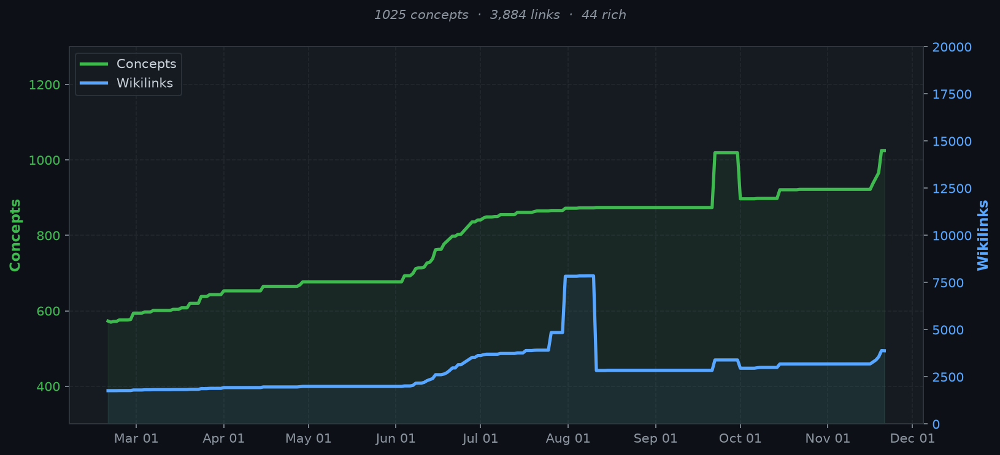

<div align="center">

# 🧠 Personal knowledge graph

**A personal ontology of data science, ML and AI, kept as an Obsidian vault and checked by a logic reasoner.**

[](#)
[](#-structure)
[](schema.yml)
[](#-logic-gate)

</div>

---

> **Not a glossary, a graph.** Each concept is a Markdown note whose YAML frontmatter holds typed relations to other concepts. A Datalog reasoner derives what follows from them, and refuses any edit that would make the graph contradict itself.

## ✨ November 2026 upgrade: from thesaurus to ontology

The vault moved from a loose thesaurus (325 ad-hoc keys, `broader` meaning anything) to a declared ontology.

| | Before | Now |
|---|---|---|
| **Schema** | none: keys invented on the fly | [`schema.yml`](schema.yml): 42 properties, 5 classes, each with its standard, inverse, transitivity, domain/range and Wikidata mapping |
| **Hierarchy** | `broader`, `subclass of`, `part of` all read as "is a kind of" | ISO 25964 split: `iso-thes:broaderGeneric` (kind of), `iso-thes:broaderInstantial` (instance of), `iso-thes:broaderPartitive` (part of), `skos:broader` (thematic shelving only) |
| **Wikidata** | property labels copied into notes | an input translated to `skos:exactMatch wd:Q…`, `skos:closeMatch`, `dcterms:subject`…; world facts in `cache/wikidata.jsonl` |
| **Inferences** | written back into the notes, never cleaned | `inferred/<note>.json`, rewritten on every pass |
| **Consistency** | checked by hand | a logic gate refuses incoherent writes from Claude Code, the MCP server and pull requests |
| **Validation** | none | `scripts/validate.py`: keys outside the schema, domain/range, duplicates, SKOS S13/S14/S27 |

The migration ran in one commit per type of change ([PR #13](https://github.com/ArthurSrz/data_knowledge_graph/pull/13)), with the gate checking every step. Plan and status: phases 0–2 done; next are the review of the remaining `skos:broader` edges, provenance (PROV-O from git history), a schema-driven reasoner, the situational layer (which concepts to combine, in which situation, for which goal) and an OWL export.

## 📈 Growth



Updated daily by [`daily-stats.yml`](.github/workflows/daily-stats.yml).

## 🏗️ Structure

A note, as stored in `graph/process owner.md`:

```yaml
---
skos:exactMatch: "wd:Q1418701"
iso-thes:broaderGeneric: "[[person]]"
kg:accountableFor: "[[business process]]"
---
The person accountable for a business process, its design and its performance…
```

A process owner *is a* person (a continuant) who is *accountable for* a business process (an occurrent). It is not a kind of process, so there is no hierarchical link to it: the gate would refuse one, since continuant and occurrent are disjoint.

Main relations in use:

| Key | Meaning | Edges |
|---|---|---:|
| `skos:broader` | thematic shelving (navigation only) | 247 |
| `iso-thes:broaderGeneric` | is a kind of (Wikidata P279), inherited | 231 |
| `iso-thes:broaderInstantial` | is an instance of (P31) | 141 |
| `has part` / `iso-thes:broaderPartitive` | part–whole (P527 / P361) | 169 |
| `skos:related` and sub-properties (`kg:uses`, `kg:oppositeOf`, `kg:accountableFor`…) | associative links | 140+ |
| `kg:disjointWith` | disjoint classes (e.g. continuant / occurrent) | 2 |

## 🔬 Reasoning

[`scripts/reason.py`](scripts/reason.py) runs 24 Datalog rules on [Semantica](https://github.com/semantica-agi/semantica): transitive hierarchy, inverses, symmetry, instance typing, part–whole closure, and the integrity checks (cycles, SKOS S27, opposites, disjointness, instance/subclass crossing, part–whole cycles). No LLM involved.

```bash
python3 -m venv .venv-gate && .venv-gate/bin/pip install --no-deps -r requirements-gate.txt   # ~10 s, no torch

.venv-gate/bin/python scripts/reason.py check                       # integrity report
.venv-gate/bin/python scripts/reason.py query "ancestor(process owner, ?X)"
.venv-gate/bin/python scripts/reason.py write                       # refresh inferred/
.venv-gate/bin/python scripts/validate.py                           # conformance to schema.yml
```

## 🛡️ Logic gate

`reason.py gate` is the single judge of "coherent": it reasons on the graph before and after a change and refuses only **new** logical violations, with the proof chains on both sides.

| Where | How |
|---|---|
| Claude Code, every session | user-level hooks: `PreToolUse` on Write/Edit, `Stop` on the session's whole changeset ([`scripts/hooks/kg-gate.py`](scripts/hooks/kg-gate.py)) |
| Agents | MCP tool `kg_upsert_concept` in [`scripts/kg_mcp.py`](scripts/kg_mcp.py): validate, then write |
| Pull requests | required status check `kg-gate` ([`kg-gate.yml`](.github/workflows/kg-gate.yml)) |

Mode: `KG_GATE=warn|block|off` (off is logged). Every decision goes to `stats/gate-log.md`; current violations are in `stats/violations.md`.

## 🗂️ Repository

| Path | Content |
|---|---|
| `graph/` | concept notes (one file per concept) |
| `daily/` | daily notes |
| `inferred/` | facts derived by the reasoner, one JSON per note |
| `schema.yml` | the ontology schema |
| `cache/` | Wikidata world facts and values removed by the migration |
| `scripts/` | reasoner, validator, migration, GraphRAG (`kg_rag.py`), MCP server, hooks |
| `stats/` | growth data, gate log, reports |

## 🚀 Use

- **Explore**: open the vault in [Obsidian](https://obsidian.md/) and use Graph View.
- **Ground an LLM**: the `pkg` MCP server (`kg_retrieve`, `kg_concept`, `kg_neighbors`, `kg_search`) returns a concept with its typed relations and neighbourhood.
- **Export**: the keys map directly to SKOS / ISO 25964 / Dublin Core IRIs (namespaces in `schema.yml`); an OWL export is planned.

---

<div align="center">
<sub>Built with <a href="https://obsidian.md/">Obsidian</a> · Reasoned with <a href="https://github.com/semantica-agi/semantica">Semantica</a> · Stats updated daily via GitHub Actions</sub>
</div>
